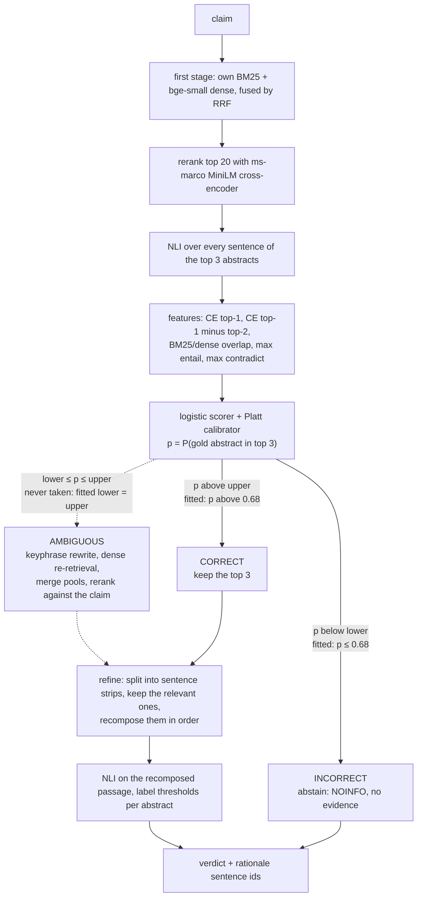
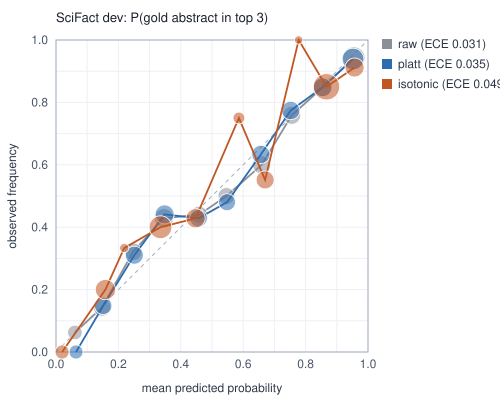
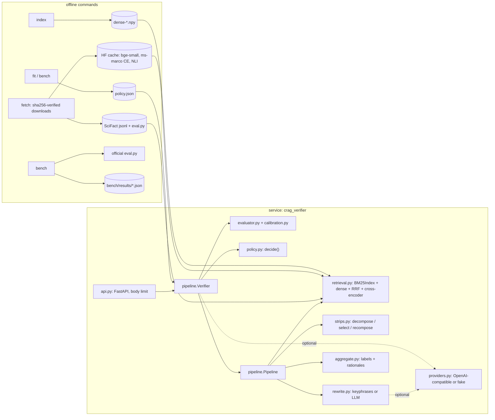

# corrective-rag-claim-verifier

A FastAPI service that checks a scientific claim against the 5,183 SciFact abstracts and
answers SUPPORT, CONTRADICT or NOINFO with the sentence ids that justify it. Before it
trusts what it retrieved, a small evaluator estimates the probability that a gold abstract
is among the top three. That calibrated number chooses between the corrective actions:
refine the evidence into sentence strips, re-retrieve with a rewritten query, or abstain.
The SciFact leaderboard script scores it against plain retrieve-then-read RAG. As fitted
on SciFact train, the policy is two-way: it abstains when `p` is at or below 0.68 and
otherwise refines the top three. Re-retrieval never had the best expected utility on
train, so the fitted service never runs it.

On SciFact dev, strip refinement does the work. Top-3 retrieval with strip refinement
reaches 0.413 abstract label-only F1, against 0.301 for standard RAG (paired 95% CI of the
gain: 0.057 to 0.169). The full system adds the evaluator in front and scores 0.389. It
abstains on 182 of the 300 claims, which removes 50 wrong abstract labels and 18 right
ones. Precision rises from 0.430 to 0.520 and recall falls from 0.397 to 0.311. On all
three official metrics, evaluator triage lowered F1 a little, though not significantly. It
did raise the per-claim utility it was fitted for.

## POST /verify

```bash
curl -s localhost:8000/verify -H 'content-type: application/json' \
     -d '{"claim": "PD-1 triggering on monocytes reduces IL-10 production by monocytes."}'
```

```json
{
  "claim": "PD-1 triggering on monocytes reduces IL-10 production by monocytes.",
  "system": "crag",
  "verdict": "CONTRADICT",
  "verdict_probability": 0.7755,
  "action": "correct",
  "abstained": false,
  "evaluator_confidence": 0.858,
  "rewritten_query": null,
  "evidence": [
    {
      "doc_id": 10648422,
      "title": "Programmed death-1–induced interleukin-10 production by monocytes impairs CD4+ T cell activation during HIV infection",
      "label": "CONTRADICT",
      "probability": 0.7755,
      "rationale_sentence_ids": [3, 4, 5],
      "rationale": [
        {"id": 3, "text": "Here we show that high amounts of microbial products … (shortened)"},
        {"id": 4, "text": "Triggering of PD-1 expressed on monocytes by PD-L1 … induced IL-10 production …"},
        {"id": 5, "text": "We describe a new function for PD-1 … (shortened)"}
      ]
    },
    {"doc_id": 9334631, "title": "C-reactive protein decreases interleukin-10 secretion in activated human monocyte-derived macrophages via inhibition of cyclic AMP production.",
     "label": "NOINFO", "probability": 0.0, "rationale_sentence_ids": [], "rationale": []},
    {"doc_id": 34469966, "title": "Human Monocytes Engage an Alternative Inflammasome Pathway.",
     "label": "NOINFO", "probability": 0.0, "rationale_sentence_ids": [], "rationale": []}
  ],
  "explanation": null,
  "explanation_status": "not_requested",
  "trace": [
    {"step": "retrieve", "ms": 1589.01, "detail": {"top": [{"doc_id": 10648422, "ce_score": 6.3459},
      {"doc_id": 9334631, "ce_score": 2.4822}, {"doc_id": 34469966, "ce_score": 2.2245}], "pool_size": 20}},
    {"step": "nli", "ms": 1474.93, "detail": {"sentences": 26}},
    {"step": "evaluate", "ms": 0.2, "detail": {
      "features": {"ce_top1": 6.3459, "ce_gap12": 3.8637, "bm25_dense_agreement": 0.3,
                   "nli_max_entail": 0.2944, "nli_max_contradict": 0.9728},
      "confidence": 0.858, "thresholds": {"lower": 0.6815561038595773, "upper": 0.6815561038595773},
      "action": "correct", "triage": true}},
    {"step": "refine", "ms": 796.07, "detail": {"mode": "strips", "abstracts": {
      "10648422": {"entail": 0.1318, "contradict": 0.7755, "kept_sentence_ids": [3, 4, 5]},
      "9334631": {"entail": 0.0, "contradict": 0.0, "kept_sentence_ids": []},
      "34469966": {"entail": 0.0, "contradict": 0.0, "kept_sentence_ids": []}}}},
    {"step": "aggregate", "ms": 0.02, "detail": {
      "labels": {"10648422": "CONTRADICT", "9334631": "NOINFO", "34469966": "NOINFO"},
      "params": {"support": 0.012, "contradict": 0.5604}}}
  ]
}
```

That is a real exchange with the service running on SciFact, the three ONNX models and the
policy fitted by the published benchmark run. Only the layout and the rationale texts were
shortened. The full response, a second exchange in which the service abstains, and the
machine, date and commit are in `bench/results/verify-examples.json`. The step times in a
trace come from a single request and move with machine load; the latency section below is
the measurement. The claim is from SciFact dev, where the gold answer is CONTRADICT on
abstract 10648422 with rationale sentences 4 and 5. The evaluator put the chance of a gold
abstract in the top 3 at 0.858, above the cut at 0.68, so the service kept the top 3 and
refined them. Strip refinement kept sentences 3 to 5 of the right abstract and dropped
every sentence of the other two.

With nothing downloaded, `crag-verifier serve --backend demo` runs the same code on twelve
invented abstracts with word-overlap stand-in models. Its policy is fitted at startup on 24
invented claims; it abstains on claims the corpus never mentions and refines the rest. Like
the SciFact policy, it has no re-retrieval band. The demo exists for the tests and the
container smoke run.

Other request fields: `"system"` selects one of the six compared pipelines
(`standard_rag`, `always_expand`, `crag_no_strips`, `standard_rag_strips`,
`always_expand_strips`, `crag`), and `"always_expand"` is the way to see the re-retrieval
branch run. `"explain": true` asks a configured LLM endpoint for a two-sentence
explanation. Claims longer than 1000 characters get 422; bodies over 8 KiB get 413. The
OpenAPI schema is at `/docs`.

## How the three actions are chosen



`lower` and `upper` are not hand-set. On SciFact train, every claim is run through both
acting branches and each outcome is scored: correct abstract labels minus wrong ones, with
abstaining worth zero. Each claim is labelled by an aggregator fitted on the other four
folds, so the scores are held out. That gives each action an expected utility that is a
straight line in `p`, and the thresholds are where the best line changes
([ADR 1](docs/adr/0001-thresholds-from-measured-utility.md)).

What the fit measured with strip-refined evidence, summed over the train claims (right
minus wrong abstract labels):

| Retrieval was | Claims | Abstain | Re-retrieve, then refine (AMBIGUOUS) | Refine the top 3 (CORRECT) |
|---|---|---|---|---|
| right (a gold abstract in the top 3) | 448 | 0 | +68 | +69 |
| wrong | 361 | 0 | -120 | -119 |

Re-retrieving is worth one label less than refining in both rows, so its line never
reaches the top and AMBIGUOUS drops out. The CORRECT line, `p·69/448 - (1-p)·119/361`,
crosses zero at `p` = 0.68. Below that, abstaining is worth more; above it, refining is.
That is the fitted rule: lower = upper = 0.68. On held-out train probabilities this policy
abstains on 492 of the 809 claims and nets 16 labels, where always refining nets -50.

With sentence-level evidence (no strip refinement), acting loses labels even when
retrieval is right (-37 for re-retrieval and -40 for refinement over those 448 claims).
When it is wrong, the losses are 260 and 259 over 361 claims. The fit therefore sets
lower = upper = 1.0, and that system abstains on every claim.

## Quick start

```bash
uv sync
uv run crag-verifier fetch     # SciFact + official evaluator into $CRAG_VERIFIER_DATA_DIR,
                               # three ONNX models (about 240 MB) into the Hugging Face cache
uv run crag-verifier index     # encode 5,183 abstracts with bge-small on the CPU, cached as .npy
uv run crag-verifier fit       # fit evaluator, calibrator, thresholds and aggregator on train
uv run crag-verifier serve     # http://127.0.0.1:8000/docs
```

`index` is the slowest one-off step: it encodes every abstract and prints progress every
640 of them. Its time was not recorded in a results file; expect tens of minutes on a
desktop CPU. `fit` took 1,226 s in the last recorded run that started with an empty
score cache, almost all of it model forward passes over the 809 train claims. Outputs are
memoised in a SQLite file in the data directory, so running `fit` or `bench` again takes
seconds (8 s for the fit in the latest run).

`fit`, or the benchmark, which does the same and more, writes `policy.json` into the data
directory. The service refuses to start on SciFact without it and says which command is
missing. To try the service with nothing downloaded:

```bash
uv run crag-verifier serve --backend demo
```

In a container (runs as uid 10001, health probe on `/health`):

```bash
docker build -t crag-verifier .
docker run -p 8000:8000 -e CRAG_VERIFIER_BACKEND=demo crag-verifier
# SciFact: mount the data directory (policy.json, index, SciFact) and the model cache
docker run -p 8000:8000 \
  -v "${CRAG_VERIFIER_DATA_DIR:-$HOME/.cache/corrective-rag-claim-verifier}:/data:ro" \
  -v "${HF_HOME:-$HOME/.cache/huggingface}:/models:ro" \
  crag-verifier
```

The service only reads both mounts, but uid 10001 inside the container must be allowed to
read them. On Linux, files created by another user with a restrictive umask may need
`chmod -R o+rX` on the two directories first.

| Variable | Default | Meaning |
|---|---|---|
| `CRAG_VERIFIER_DATA_DIR` | `~/.cache/corrective-rag-claim-verifier` | SciFact, evaluator, dense index, score cache, `policy.json` |
| `HF_HOME` | `~/.cache/huggingface` | where the ONNX models are cached |
| `CRAG_VERIFIER_BACKEND` | `onnx` | `demo` swaps in the synthetic corpus and lexical models |
| `CRAG_VERIFIER_POLICY` | `$CRAG_VERIFIER_DATA_DIR/policy.json` | fitted policy to load |
| `CRAG_VERIFIER_THREADS` | ONNX Runtime default | intra-op threads per model |
| `CRAG_VERIFIER_LLM_BASE_URL`, `CRAG_VERIFIER_LLM_MODEL`, `CRAG_VERIFIER_LLM_API_KEY` | unset | any server that speaks the OpenAI chat-completions protocol, local or hosted; used for explanations |
| `CRAG_VERIFIER_REWRITER` | `keyphrase` | `llm` sends the AMBIGUOUS rewrite to that endpoint |

## SciFact dev, scored by the official script

Six systems share the retriever, the models and every parameter fitted on train. They
form a grid: retrieval policy (always the top 3, always re-retrieve, or evaluator triage)
crossed with evidence handling (every sentence through NLI, or strip refinement). All 300
dev claims, full 5,183-abstract corpus.

| System | Retrieval policy | Evidence handling | Abstract label-only F1 [95% CI] | Abstract rationalized F1 | Sentence selection+label F1 | Abstract labels right / wrong |
|---|---|---|---|---|---|---|
| standard RAG | top 3, always | every sentence through NLI | 0.301 [0.251, 0.352] | 0.211 | 0.143 | 80 / 242 |
| always-expand | rewrite + re-retrieve, always | every sentence through NLI | 0.301 [0.251, 0.351] | 0.211 | 0.143 | 80 / 243 |
| CRAG without strip refinement | evaluator triage | every sentence through NLI | 0.000 | 0.000 | 0.000 | 0 / 0 |
| top 3 + strips | top 3, always | strips: filter, recompose, one NLI read | 0.413 [0.346, 0.479] | 0.323 | 0.234 | 83 / 110 |
| always-expand + strips | rewrite + re-retrieve, always | strips | 0.413 [0.346, 0.479] | 0.323 | 0.234 | 83 / 110 |
| CRAG | evaluator triage | strips | 0.389 [0.321, 0.456] | 0.311 | 0.210 | 65 / 60 |
| CRAG, LLM query rewrite | evaluator triage | strips | not run | not run | not run | not run (needs an LLM endpoint) |

Paired differences, each row first system minus second, with 95% CIs from 10,000
resamples of the dev claims:

| Comparison | What it isolates | Label-only F1 | Rationalized F1 | Sentence selection+label F1 |
|---|---|---|---|---|
| top 3 + strips minus standard RAG | strip refinement | 0.112 [0.057, 0.169] | 0.112 [0.062, 0.165] | 0.091 [0.046, 0.136] |
| CRAG minus standard RAG | strips and triage together | 0.088 [0.032, 0.145] | 0.100 [0.046, 0.155] | 0.067 [0.023, 0.112] |
| top 3 + strips minus CRAG | switching triage off | 0.024 [-0.018, 0.069] | 0.012 [-0.023, 0.050] | 0.023 [-0.004, 0.054] |

Where the differences come from:

* **Strips.** Reading only the strips that survive refinement cuts wrong labels from 242 to
  110 and gains three right ones. Precision goes from 0.248 to 0.430, recall from 0.383 to
  0.397. The whole improvement over standard RAG comes from this step.
* **Triage on top of strips.** On the 182 claims CRAG abstains on, top 3 + strips had
  produced 18 right and 50 wrong labels. Dropping them lifts precision to 0.520 but costs
  recall (0.311), and F1 weighs that loss more. CRAG scored at or below top 3 + strips in
  86%, 74% and 95% of the paired resamples on the three metrics. None of the intervals
  excludes zero, so the drop is not significant, but there is no sign of a gain either.
* **The objective triage was fitted for.** Net labels, right minus wrong, are -162 for
  standard RAG and -27 for top 3 + strips. CRAG nets +5, the only system above abstaining
  on everything. Triage does what the utility asked of it. Per-claim net labels and F1
  disagree about whether that is worth it, which is the main weakness of the design (see
  [Where it falls short](#where-it-falls-short)).
* **Re-retrieval.** With strips, always-expand scores exactly the same as the top 3 on
  every metric. With sentence-level NLI, it ends with the same right labels and one more
  wrong one.
* **CRAG without strip refinement** is zero because its fitted policy abstains on every
  claim. Sentence-level NLI with these models gives three wrong labels for each right one
  (80 / 242 on dev), and on train acting lost labels even when retrieval was right.

F1 values come from `evaluator/eval.py` of `allenai/scifact-evaluator`. The in-repo metric
used for the bootstrap matched it on every metric of all six systems, with differences
below 1e-9 ([ADR 4](docs/adr/0004-official-evaluator-as-the-scorer.md)).

Run record: `bench/results/scifact-dev.json`, produced on 2026-10-11 by
`uv run crag-verifier bench` at commit `43cd5b0`, the run that also timed the requests in
[/verify latency](#verify-latency). Measured on one
Windows 10 desktop: Intel i5-8500 (6 cores), 12 GB RAM (11.9 GB visible to the OS), CPU
only with no GPU, Python 3.12, onnxruntime 1.31.

## Is the evaluator's confidence worth trusting?

The thresholds only make sense if `p` means what it says. The scorer is trained on train;
each calibrator is fitted on 5-fold out-of-fold train scores and then applied to dev. The
target is "a gold abstract is among the top 3 of the initial retrieval", which holds for
169 of the 300 dev claims (0.563).

| Calibration | AUROC | ECE (10 bins) | Brier | Log-loss |
|---|---|---|---|---|
| none (logistic output) | 0.824 | 0.031 | 0.170 | 0.508 |
| Platt (used by the policy) | 0.824 | 0.035 | 0.170 | 0.507 |
| isotonic | 0.822 | 0.049 | 0.170 | 0.506 |

Platt was chosen on train by held-out log-loss (0.497 against 0.589 for isotonic). On dev,
the logistic output was already about as well calibrated, so neither calibrator bought
anything measurable here. On train, the probabilities the threshold fit uses are nested
held-out ones: for each fold, both the scorer and the calibrator were fitted without it.
They have AUROC 0.840, ECE 0.047 and Brier 0.162.



## When it abstains and why

The service abstains only through the INCORRECT action. That happens when the calibrated
chance that any of the top three abstracts is a gold one is so low that, on train, acting
on such retrievals produced more wrong labels than right ones. Abstaining returns NOINFO
with no evidence, which the SciFact metric counts as neither a hit nor a false alarm.
Separately, the aggregator returns NOINFO for a single abstract when no strip survives
refinement or the NLI probability is below the fitted label threshold. That is not counted
as an abstention below.

| | CRAG without strip refinement | CRAG |
|---|---|---|
| claims abstained on (of 300) | 300 | 182 |
| of those, share whose gold label is NOINFO (112 of 300 overall) | 0.373 | 0.544 |
| of those, share with no gold abstract in the initial top 3 (131 of 300 overall) | 0.437 | 0.637 |
| labels the same evidence path gave those claims without triage, right / wrong | 80 / 242 | 18 / 50 |
| fitted thresholds (lower, upper) | 1.0, 1.0 | 0.68, 0.68 |

CRAG's abstentions are enriched for both kinds of hopeless claim, but they are not clean.
In 66 of the 182, a gold abstract was in the top 3. The first six abstained dev claims, as
stored in `dev.abstention.examples`:

| Claim id | Claim | `p` | Gold label NOINFO | Gold abstract in top 3 |
|---|---|---|---|---|
| 1 | 0-dimensional biomaterials show inductive properties. | 0.048 | yes | no |
| 3 | 1,000 genomes project enables mapping of genetic sequence variation consisting of rare variants with larger penetrance effects than common variants. | 0.421 | no | yes |
| 5 | 1/2000 in UK have abnormal PrP positivity. | 0.248 | no | yes |
| 13 | 5% of perinatal mortality is due to low birth weight. | 0.131 | yes | no |
| 36 | A deficiency of vitamin B12 increases blood levels of homocysteine. | 0.407 | yes | no |
| 48 | A total of 1,000 people in the UK are asymptomatic carriers of vCJD infection. | 0.130 | no | no |

Claims 3 and 5 are the costly kind. A gold abstract was retrieved, but no sentence of the
top 3 read as entailing the claim (highest entailment 0.016 and 0.035), and `p` stayed
under the threshold. The utility sums, the held-out action mix on train and the features
of these claims are stored under `train_fit.thresholds` and `dev.abstention` in the results
JSON. Per-claim actions and predictions for all 300 claims go to the git-ignored
`bench/runs/`.

## /verify latency

Sequential requests over loopback HTTP to a server running the full CRAG system with the
ONNX models and no score cache, after two warm-up requests, on the first 100 dev claims.
Measured on the same desktop on 2026-10-11 at commit `43cd5b0`, under the fitted policy
described above: it abstained on 51 of the 100 claims and refined the top 3 of the other
49, with no re-retrieval. The desktop was not otherwise idle. In the minute before the
run, other applications and the Docker VM kept total CPU use at 43% on average, and the
ONNX sessions share the same six cores with them.

| Requests | p50 | p95 | Mean | Max | Slowest step (median) |
|---|---|---|---|---|---|
| 100 | 1,417 ms | 2,773 ms | 1,559 ms | 3,889 ms | retrieve, 648 ms |
| with `"explain": true` | not run (needs an LLM endpoint) | | | | |

Median step times: retrieve 648 ms, NLI over the top-3 sentences 520 ms, refine 427 ms
(over the 49 refined requests), evaluate 0.09 ms. An abstained request ends after the
evaluator, so it pays for retrieval and NLI only. Source:
`bench/results/scifact-dev-latency.json`, same machine as above.

## Architecture



| Module | What it holds |
|---|---|
| `bm25.py` | Okapi BM25 on a numpy inverted index (k1 0.9, b 0.4), top-k with ties broken by document index |
| `retrieval.py` | BM25 + dense first stage, reciprocal rank fusion, cross-encoder rerank, expansion for AMBIGUOUS |
| `evaluator.py` | the five features, out-of-fold scoring, calibration choice, nested held-out probabilities |
| `calibration.py` | Newton-fitted logistic regression, Platt, isotonic (pool adjacent violators), ECE, reliability bins, AUROC, Brier |
| `policy.py` | actions, threshold rule, utility table, expected-utility envelope, constrained grid fallback |
| `strips.py` | decomposition into sentence strips, relevance selection, recomposition, rationale ids |
| `aggregate.py` | NLI evidence per abstract, label thresholds and their fit, claim verdict |
| `rewrite.py` | RAKE-style keyphrase rewriting scored by BM25 IDF; provider-backed rewrite with fallback |
| `scifact_metrics.py` | official SciFact counting per claim, right/wrong label counts, paired bootstrap |
| `fit.py`, `bench.py` | train-only fitting; the benchmark harness |
| `models.py`, `fakes.py` | ONNX Runtime wrappers; lexical doubles for tests and the demo backend |

Written for this project: everything in that table. Used as libraries: ONNX Runtime and
`tokenizers` to run the three models, FastAPI and uvicorn for the service, numpy, and
`huggingface_hub` to download. scikit-learn appears only in the tests, as the reference
the AUROC, isotonic, Platt and logistic implementations are checked against.

The cross-encoder and NLI exports are dynamically quantised to int8, and such a model
derives its activation scale from the whole input tensor. A pair's score therefore used
to shift with whatever shared its batch. Both models now run one sequence at a time,
which on this CPU was no slower and makes every score a function of its pair alone. The
service and the benchmark now produce the same features for the same claim. For claim 13,
`dev.abstention.examples` in the results JSON and the second exchange in
`verify-examples.json` agree on every feature and on `p`.

## Running the benchmark

```bash
uv run crag-verifier fetch
uv run crag-verifier bench                       # writes bench/results/scifact-dev.json
uv run crag-verifier bench --latency-requests 0  # quality only, no /verify timing
```

It builds the dense index if missing, fits on all 809 train claims, runs the six systems on
all 300 dev claims, scores them with the official script, bootstraps the paired intervals,
and times 100 `/verify` requests into `scifact-dev-latency.json`. Model outputs are
memoised, so the six systems and any re-run pay for each forward pass once; the latency
measurement bypasses that cache. Predictions and the official script's metric files go to
`bench/runs/` (git-ignored), the summary to the results JSON plus a reliability-diagram
SVG next to it. The run also rewrites `policy.json` in the data directory, which is the
policy the service then loads.

The latest full run, which wrote both results files, took 178 s on the warm score cache,
of which 8 s fitting on train, 5 s running the six systems on dev and 159 s timing
requests. From an empty score cache, model forward passes dominate: the last run that
started empty (2026-10-09, commit `ad7dd1f`, four systems at the time) took 1,838 s, of
which 1,226 s fitting on train, 455 s on dev and 151 s timing requests. Its timings are
kept under `cold_cache_run` in `scifact-dev.json`. The dense index was already on disk in
both runs, so its encoding time is not part of either. An earlier full run, made before
the int8 batching fix, was discarded, and none of its numbers appear here.

`bench --smoke` runs the same harness on 25 train and 12 dev claims with a 120-abstract
corpus sample to check that it works end to end. It writes
`bench/results/smoke-scifact-dev.json`, which git ignores, and refuses an output name that
does not start with `smoke-`, so a smoke run cannot overwrite the published results.

## Data, models and licences

| Artifact | Source | Licence | In this repo |
|---|---|---|---|
| SciFact corpus and claims | `scifact.s3-us-west-2.amazonaws.com/release/latest/data.tar.gz` (AllenAI) | CC BY-NC 2.0 | no; fetched and sha256-checked |
| SciFact evaluator `eval.py` | `allenai/scifact-evaluator` at `66feffc5` | Apache-2.0 | no; fetched and sha256-checked |
| `BAAI/bge-small-en-v1.5`, `onnx/model.onnx` | Hugging Face Hub at `5c38ec7c` | MIT | no |
| `cross-encoder/ms-marco-MiniLM-L6-v2`, `onnx/model_quint8_avx2.onnx` | Hugging Face Hub at `233902d2` | Apache-2.0 | no |
| `cross-encoder/nli-MiniLM2-L6-H768`, `onnx/model_quint8_avx2.onnx` | Hugging Face Hub at `b95119ce` | Apache-2.0 | no |
| SciFact claims, titles and sentences quoted in this README and `bench/results/` | SciFact (AllenAI) | CC BY-NC 2.0, non-commercial; see [NOTICE](NOTICE) | yes, as quotations |
| demo corpus and claims | written for this repo, entirely invented | MIT | `src/crag_verifier/demo/` |
| this repository's code | | MIT, [LICENSE](LICENSE) | yes |

Pinned sha256 values live in `src/crag_verifier/artifacts.py`.

## Where it falls short

* **The calibrated evaluator did not improve F1.** Everything the full system gains over
  standard RAG comes from strip refinement. Adding triage on top lowered all three
  official metrics slightly; the drop is not significant, but no metric moved up. It
  improved net labels per claim, which is what the thresholds maximise. That linear
  utility is a stand-in for F1, and on this data the two disagree.
* **Three-way triage collapsed to two-way.** On train, re-retrieving was worth one label
  less than refining whether or not retrieval was right, so the fitted policy has no
  AMBIGUOUS band. On dev, keyphrase re-retrieval left every strip-based metric unchanged.
* **Sentence-level evidence is not worth acting on** with these models: the
  utility-optimal policy abstains on everything, so "CRAG without strip refinement" scores
  zero.
* **Abstention is blunt.** In 66 of CRAG's 182 abstentions, a gold abstract had been
  retrieved.
* **Small sample.** Only dev was scored (300 claims), not the hidden test split, and the
  label-only F1 intervals of the strip systems and CRAG overlap widely.
* The NLI model is a general-domain MNLI/SNLI cross-encoder used zero-shot on biomedical
  claims. Only its operating point is adapted (label thresholds fitted on train).
* The planned `xtremedistil-l6-h256` NLI model exists publicly only as binary
  entail/not-entail checkpoints, which cannot produce a contradiction probability. It was
  replaced by a three-class model that is slower per token
  ([ADR 2](docs/adr/0002-three-class-nli-model.md)).
* The evaluator's target, "a gold abstract is in the top 3", is defined against this
  retriever. A better retriever changes both the base rate and the thresholds, so the
  policy has to be refitted with it.
* About 800 train claims fix the calibrator, the strip relevance cut-off, two pairs of
  action thresholds and four label thresholds. Nothing is tuned on dev. The aggregator's
  own train F1 in the fit report is in-sample; the utilities and probabilities behind the
  thresholds are held out.
* The LLM query rewrite and the LLM explanation are implemented behind the provider
  interface but **not run** in any reported number; all results use keyphrase rewriting.
* Latency is for one request at a time on one desktop CPU that was also running other
  applications. The service serialises verifications because each ONNX session already
  uses every core.
* `--backend demo` exists for tests and smoke runs. Its corpus is invented and its models
  are word-overlap rules; it verifies nothing real.

## What the tests pin down

The failures this project is most exposed to are silent ones, so the tests target them.
The in-repo SciFact metric must reproduce the official script's recorded output on an
edge-case fixture, and every benchmark run re-checks it against the real script. With
hypothesis, the fitted threshold rule is checked to pick the utility-optimal action at
every confidence, cut points included, whenever the utility lines admit a threshold rule.
Actions never step down as `p` rises, isotonic calibration and AUROC match scikit-learn,
ECE matches a brute-force loop, and strip decomposition keeps every sentence id, in
order. BM25 is checked against the textbook formula. The API contract
covers 422s and the 8 KiB body limit, declared and streamed. Another test checks that the
int8 models give a pair the same output alone and in a batch; it needs the real models, so
it is marked `integration`.

`uv run pytest` runs the offline suite on fakes and fixtures; `uv run pytest -m
integration` adds the tests that need `crag-verifier fetch`. CI
(`.github/workflows/ci.yml`) runs ruff, the offline suite and a demo-backend CLI call that
must abstain. It then builds the image and runs `.github/container_smoke.py` against it:
health probe, uid 10001, one claim through each of the refine, abstain and re-retrieve
paths, a 422 and a 413.

Design records: [thresholds](docs/adr/0001-thresholds-from-measured-utility.md),
[NLI model](docs/adr/0002-three-class-nli-model.md),
[strips as rationales](docs/adr/0003-strip-refinement-and-rationales.md),
[official scoring](docs/adr/0004-official-evaluator-as-the-scorer.md),
[int8 models one sequence at a time](docs/adr/0005-int8-models-score-one-sequence-per-run.md).
