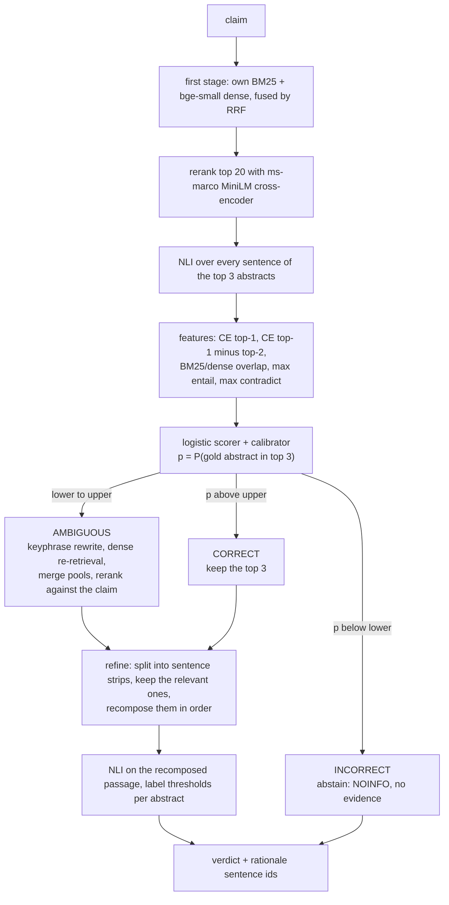
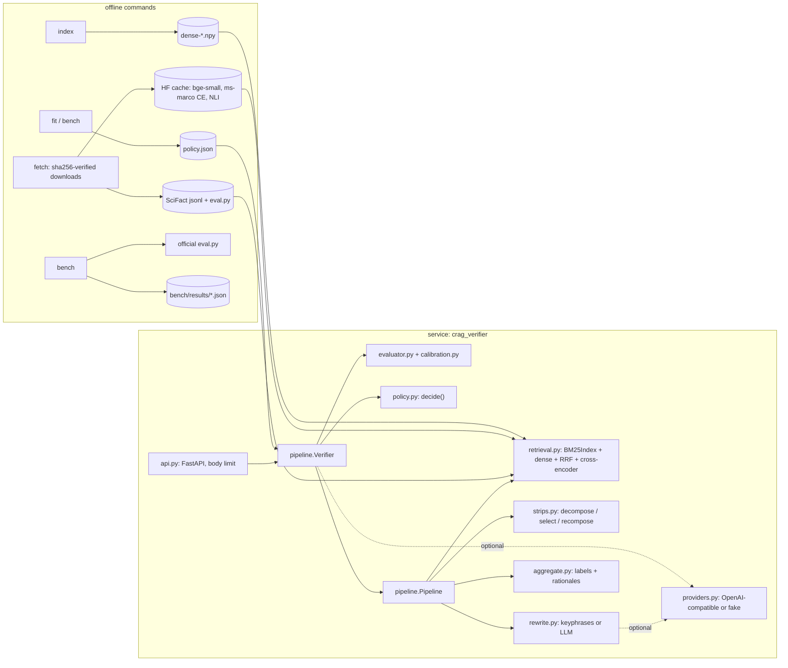

# corrective-rag-claim-verifier

A FastAPI service that checks a scientific claim against the 5,183 SciFact abstracts and
answers SUPPORT, CONTRADICT or NOINFO with the sentence ids that justify it. Before it
trusts what it retrieved, a small evaluator estimates the probability that a gold abstract
is among the top three, and that calibrated number picks one of three corrective actions:
refine the evidence, re-retrieve with a rewritten query, or abstain. The SciFact
leaderboard script scores it against plain retrieve-then-read RAG.

## POST /verify

```bash
curl -s localhost:8000/verify -H 'content-type: application/json' \
     -d '{"claim": "Knockdown of TRX-9 reduces axon growth."}'
```

```json
{
  "claim": "Knockdown of TRX-9 reduces axon growth.",
  "system": "crag",
  "verdict": "CONTRADICT",
  "verdict_probability": 0.95,
  "action": "correct",
  "abstained": false,
  "evaluator_confidence": 1.0,
  "rewritten_query": null,
  "evidence": [
    {
      "doc_id": 103,
      "title": "[synthetic] TRX-9 protein in neuronal growth",
      "label": "CONTRADICT",
      "probability": 0.95,
      "rationale_sentence_ids": [1],
      "rationale": [{"id": 1, "text": "Knockdown of TRX-9 did not reduce axon growth in culture."}]
    },
    {"doc_id": 111, "title": "[synthetic] Gut microbiome diversity after antibiotics",
     "label": "NOINFO", "probability": 0.0, "rationale_sentence_ids": [], "rationale": []},
    {"doc_id": 105, "title": "[synthetic] Mirelle syndrome prevalence",
     "label": "NOINFO", "probability": 0.0, "rationale_sentence_ids": [], "rationale": []}
  ],
  "explanation": null,
  "explanation_status": "not_requested",
  "trace": [
    {"step": "retrieve", "ms": 0.86, "detail": {"top": [{"doc_id": 103, "ce_score": 5.0},
      {"doc_id": 111, "ce_score": -3.3333}, {"doc_id": 105, "ce_score": -5.0}], "pool_size": 12}},
    {"step": "nli", "ms": 0.53, "detail": {"sentences": 8}},
    {"step": "evaluate", "ms": 0.07, "detail": {
      "features": {"ce_top1": 5.0, "ce_gap12": 8.3333, "bm25_dense_agreement": 0.2,
                   "nli_max_entail": 0.1056, "nli_max_contradict": 0.95},
      "confidence": 1.0, "thresholds": {"lower": 0.0, "upper": 0.0}, "action": "correct", "triage": true}},
    {"step": "refine", "ms": 0.24, "detail": {"mode": "strips", "abstracts": {
      "103": {"entail": 0.05, "contradict": 0.95, "kept_sentence_ids": [1]},
      "111": {"entail": 0.0, "contradict": 0.0, "kept_sentence_ids": []},
      "105": {"entail": 0.0, "contradict": 0.0, "kept_sentence_ids": []}}}},
    {"step": "aggregate", "ms": 0.02, "detail": {
      "labels": {"103": "CONTRADICT", "111": "NOINFO", "105": "NOINFO"},
      "params": {"support": 0.05, "contradict": 0.05}}}
  ]
}
```

That exchange is real output, reformatted, of `crag-verifier verify --backend demo`, which
runs the whole pipeline on twelve invented abstracts with lexical stand-in models, so it
reproduces without any download. The same request against SciFact with the ONNX models
and the policy fitted on train: *pending benchmark* (the benchmark run writes the policy
file).

Other request fields: `"system"` selects one of the four compared pipelines
(`standard_rag`, `always_expand`, `crag_no_strips`, `crag`), and `"explain": true` asks a
configured LLM endpoint for a two-sentence explanation. Claims longer than 1,000
characters get 422; bodies over 8 KiB get 413. The OpenAPI schema is at `/docs`.

## How the three actions are chosen



`lower` and `upper` are not hand-set. On SciFact train every claim is run through both
acting branches and each outcome is scored (correct abstract labels minus wrong ones;
abstaining scores zero). That gives each action an expected utility that is a straight
line in `p`, and the thresholds are where the best line changes. The reasoning, and what
happens when the lines do not cooperate, is in
[ADR 1](docs/adr/0001-thresholds-from-measured-utility.md).

## Quick start

```bash
uv sync
uv run crag-verifier fetch     # SciFact + official evaluator into $CRAG_VERIFIER_DATA_DIR,
                               # three ONNX models (about 240 MB) into the Hugging Face cache
uv run crag-verifier index     # encode the corpus with bge-small, cached as an .npy
uv run crag-verifier fit       # fit evaluator, calibrator, thresholds and aggregator on train
uv run crag-verifier serve     # http://127.0.0.1:8000/docs
```

`fit` (or the benchmark, which does the same and more) writes `policy.json` into the data
directory; the service refuses to start on SciFact without it and says which command is
missing. To try the service with nothing downloaded:

```bash
uv run crag-verifier serve --backend demo
```

In a container (runs as uid 10001, health probe on `/health`):

```bash
docker build -t crag-verifier .
docker run -p 8000:8000 -e CRAG_VERIFIER_BACKEND=demo crag-verifier
# SciFact: mount the data directory (with policy.json and the index) and the model cache
docker run -p 8000:8000 -v "$CRAG_VERIFIER_DATA_DIR:/data" -v "$HF_HOME:/models" crag-verifier
```

| Variable | Default | Meaning |
|---|---|---|
| `CRAG_VERIFIER_DATA_DIR` | `~/.cache/corrective-rag-claim-verifier` | SciFact, evaluator, dense index, score cache, `policy.json` |
| `HF_HOME` | Hugging Face default | where the ONNX models are cached |
| `CRAG_VERIFIER_BACKEND` | `onnx` | `demo` swaps in the synthetic corpus and lexical models |
| `CRAG_VERIFIER_POLICY` | `$CRAG_VERIFIER_DATA_DIR/policy.json` | fitted policy to load |
| `CRAG_VERIFIER_THREADS` | ONNX Runtime default | intra-op threads per model |
| `CRAG_VERIFIER_LLM_BASE_URL`, `CRAG_VERIFIER_LLM_MODEL`, `CRAG_VERIFIER_LLM_API_KEY` | unset | OpenAI-compatible endpoint (OpenAI, Ollama, vLLM, LM Studio) for explanations |
| `CRAG_VERIFIER_REWRITER` | `keyphrase` | `llm` sends the AMBIGUOUS rewrite to that endpoint |

## SciFact dev, scored by the official script

Four systems share the retriever, the models and every parameter fitted on train; they
differ only in the corrective parts.

| System | Retrieval policy | Evidence handling | Abstract label-only F1 | Abstract rationalized F1 | Sentence selection+label F1 | Label-only F1 minus standard RAG, paired 95% CI |
|---|---|---|---|---|---|---|
| standard RAG | top 3, always | every sentence through NLI | pending benchmark | pending benchmark | pending benchmark | (baseline) |
| always-expand | rewrite + re-retrieve, always | every sentence through NLI | pending benchmark | pending benchmark | pending benchmark | pending benchmark |
| CRAG without strip refinement | evaluator triage | every sentence through NLI | pending benchmark | pending benchmark | pending benchmark | pending benchmark |
| CRAG | evaluator triage | strips: filter, recompose, one NLI read | pending benchmark | pending benchmark | pending benchmark | pending benchmark |

F1 values come from `evaluator/eval.py` of `allenai/scifact-evaluator`; the in-repo metric
used for the bootstrap must match it on every run
([ADR 4](docs/adr/0004-official-evaluator-as-the-scorer.md)). Confidence intervals: 1,000
paired resamples of the dev claims.

Measured on: Intel i5-8500 (6 cores), 12 GB RAM, Windows 10, CPU only, Python 3.12;
date: pending benchmark. Source: `bench/results/scifact-dev.json`.

## Is the evaluator's confidence worth trusting?

The thresholds only make sense if `p` means what it says. The scorer is trained on train;
each calibrator is fitted on 5-fold out-of-fold train scores and then applied to dev. Target:
a gold abstract is among the top 3 of the initial retrieval.

| Calibration | AUROC | ECE (10 bins) | Brier |
|---|---|---|---|
| none (logistic output) | pending benchmark | pending benchmark | pending benchmark |
| Platt | pending benchmark | pending benchmark | pending benchmark |
| isotonic | pending benchmark | pending benchmark | pending benchmark |

Which of Platt and isotonic the policy uses is decided on train by held-out log-loss and
recorded in the results JSON. Reliability diagram: `bench/results/scifact-dev-reliability.svg`
(pending benchmark).

## When it abstains and why

The service abstains only through the INCORRECT action: the calibrated chance that any of
the top three abstracts is a gold one is so low that, on train, acting on such retrievals
lost more correct labels than it gained. Abstaining returns NOINFO with no evidence,
which the SciFact metric counts as neither a hit nor a false alarm. Separately, the
aggregator returns NOINFO for an individual abstract when no strip survives refinement or
the NLI probability is below the fitted label threshold; that is not counted as an
abstention below.

| | CRAG without strip refinement | CRAG |
|---|---|---|
| claims abstained on (of 300) | pending benchmark | pending benchmark |
| of those, gold label is NOINFO | pending benchmark | pending benchmark |
| of those, no gold abstract in the initial top 3 | pending benchmark | pending benchmark |
| fitted thresholds (lower, upper) | pending benchmark | pending benchmark |

The utility table the thresholds were derived from, the out-of-fold action mix on train
and a handful of abstained dev claims with their feature values are stored under
`train_fit.thresholds` and `dev.abstention.examples` in the results JSON: pending benchmark.

## /verify latency

Sequential requests over loopback HTTP to a server running the full CRAG system with the
ONNX models and no score cache, after two warm-up requests.

| Requests | p50 | p95 | Slowest step (median) |
|---|---|---|---|
| pending benchmark | pending benchmark | pending benchmark | pending benchmark |

## Architecture



| Module | What it holds |
|---|---|
| `bm25.py` | Okapi BM25 on a numpy inverted index (k1 0.9, b 0.4) |
| `retrieval.py` | BM25 + dense first stage, reciprocal rank fusion, cross-encoder rerank, expansion for AMBIGUOUS |
| `evaluator.py` | the five features, out-of-fold scoring, calibration choice, the fitted evaluator |
| `calibration.py` | Newton-fitted logistic regression, Platt, isotonic (pool adjacent violators), ECE, reliability bins, AUROC, Brier |
| `policy.py` | actions, threshold rule, utility table, expected-utility envelope, constrained grid fallback |
| `strips.py` | decomposition into sentence strips, relevance selection, recomposition, rationale ids |
| `aggregate.py` | NLI evidence per abstract, label thresholds and their fit, claim verdict |
| `rewrite.py` | RAKE-style keyphrase rewriting scored by BM25 IDF; provider-backed rewrite with fallback |
| `scifact_metrics.py` | official SciFact counting per claim, paired bootstrap |
| `fit.py`, `bench.py` | train-only fitting; the benchmark harness |
| `models.py`, `fakes.py` | ONNX Runtime wrappers; lexical doubles for tests and the demo backend |

Written for this project: everything in that table. Used as libraries: ONNX Runtime and
`tokenizers` to run the three models, FastAPI and uvicorn for the service, numpy, and
`huggingface_hub` to download. scikit-learn appears only in the tests, as the reference
the AUROC, isotonic, Platt and logistic implementations are checked against.

## Running the benchmark

```bash
uv run crag-verifier fetch
uv run crag-verifier bench --out bench/results/scifact-dev.json
```

It builds the dense index if missing, fits on all 809 train claims, runs the four systems
on all 300 dev claims, scores them with the official script, and times 100 `/verify`
requests. Model outputs are memoised in a SQLite file in the data directory, so the four
systems and any re-run pay for each forward pass once; the latency measurement bypasses
that cache. Predictions and the official script's metric files go to `bench/runs/`
(git-ignored), the summary to the `--out` JSON plus a reliability-diagram SVG next to it.

Expected wall time on the machine above with the CPU to itself: about 55 to 75 minutes,
mostly cross-encoder and NLI forward passes over the 809 train claims. That is an
extrapolation from smoke runs, not a measurement. `--smoke` runs the same harness on 25
train and 12 dev claims with a 120-abstract corpus sample in under three minutes and writes
`bench/results/smoke-*`, which is not committed.

## Data and models

| Artifact | Source | Licence | In this repo |
|---|---|---|---|
| SciFact corpus and claims | `scifact.s3-us-west-2.amazonaws.com/release/latest/data.tar.gz` (AllenAI) | CC BY-NC 2.0 | no; fetched and sha256-checked |
| SciFact evaluator `eval.py` | `allenai/scifact-evaluator` at `66feffc5` | Apache-2.0 | no; fetched and sha256-checked |
| `BAAI/bge-small-en-v1.5`, `onnx/model.onnx` | Hugging Face Hub at `5c38ec7c` | MIT | no |
| `cross-encoder/ms-marco-MiniLM-L6-v2`, `onnx/model_quint8_avx2.onnx` | Hugging Face Hub at `233902d2` | Apache-2.0 | no |
| `cross-encoder/nli-MiniLM2-L6-H768`, `onnx/model_quint8_avx2.onnx` | Hugging Face Hub at `b95119ce` | Apache-2.0 | no |
| demo corpus and claims | written for this repo, entirely invented | MIT (this repo) | `src/crag_verifier/demo/` |

SciFact is for non-commercial use; claim text quoted from it in benchmark output keeps
that licence. Pinned sha256 values live in `src/crag_verifier/artifacts.py`.

## Limitations

* The NLI model is a general-domain MNLI/SNLI cross-encoder used zero-shot on biomedical
  claims. Only its operating point is adapted (label thresholds fitted on train).
* The planned `xtremedistil-l6-h256` NLI model exists publicly only as binary
  entail/not-entail checkpoints, which cannot produce a contradiction probability; it was
  replaced by a three-class model that is slower per token
  ([ADR 2](docs/adr/0002-three-class-nli-model.md)).
* The evaluator's target, "a gold abstract is in the top 3", is defined against this
  retriever. A better retriever changes both the base rate and the thresholds, so the
  policy has to be refitted with it.
* The per-claim utility (correct minus wrong abstract labels) is a linear stand-in for F1;
  maximising it is not the same as maximising F1.
* About 800 train claims fix the calibrator, three thresholds and four label thresholds.
  Dev results carry bootstrap intervals; nothing is tuned on dev, and the hidden test split
  is not scored.
* If re-retrieval does not beat refinement on train, the AMBIGUOUS band is empty and the
  policy is two-way. That is a result, not a bug, and the action counts report it.
* The LLM query rewrite and the LLM explanation are implemented behind the provider
  interface but **not run** in any reported number; all results use keyphrase rewriting.
* Latency is for one request at a time on one desktop CPU. The service serialises
  verifications because each ONNX session already uses every core.
* `--backend demo` exists for tests and smoke runs. Its corpus is invented and its models
  are word-overlap rules; it verifies nothing real.

## Development

```bash
uv run ruff check . && uv run ruff format --check .
uv run pytest                    # offline suite, under a minute: fakes and fixtures only
uv run pytest -m integration     # real models, official script; needs `crag-verifier fetch`
```

Property tests (hypothesis) cover BM25 against the textbook formula, isotonic and AUROC
against scikit-learn, ECE against a brute-force loop, calibration monotonicity, threshold
boundaries and monotone actions, and strip decomposition preserving sentence ids. The
metric is checked against the official script's recorded output on an edge-case fixture.
CI (`.github/workflows/ci.yml`) runs lint, format, the offline suite, builds the image and
smoke-tests it on the demo backend: health probe, uid 10001, a 200 and a 422.

Design records: [thresholds](docs/adr/0001-thresholds-from-measured-utility.md),
[NLI model](docs/adr/0002-three-class-nli-model.md),
[strips as rationales](docs/adr/0003-strip-refinement-and-rationales.md),
[official scoring](docs/adr/0004-official-evaluator-as-the-scorer.md).

## Licence

MIT, see [LICENSE](LICENSE). Data and model licences are listed above and are separate.
