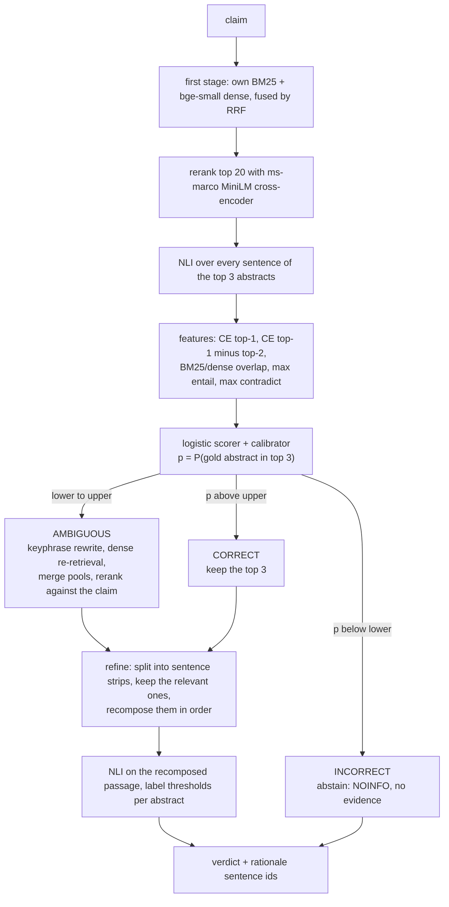
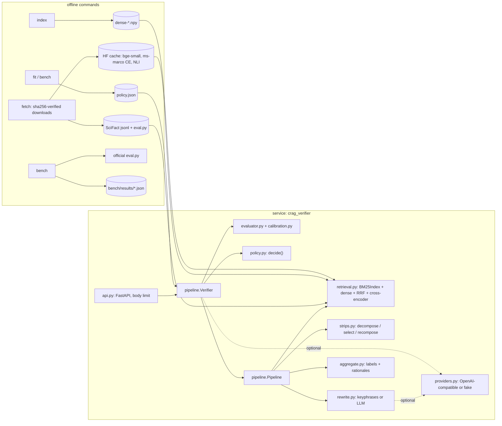

# corrective-rag-claim-verifier

A FastAPI service that checks a scientific claim against the 5,183 SciFact abstracts and
answers SUPPORT, CONTRADICT or NOINFO with the sentence ids that justify it. Before it
trusts what it retrieved, a small evaluator estimates the probability that a gold abstract
is among the top three, and that calibrated number picks one of three corrective actions:
refine the evidence, re-retrieve with a rewritten query, or abstain. The SciFact
leaderboard script scores it against plain retrieve-then-read RAG.

On SciFact dev the full system reaches 0.366 abstract label-only F1 against 0.308 for
standard RAG (paired 95% CI of the difference: 0.001 to 0.109). The whole gain is
precision: it abstains on 147 of the 300 claims and labels fewer wrong abstracts, while
recall stays at 0.311 for both.

## POST /verify

```bash
curl -s localhost:8000/verify -H 'content-type: application/json' \
     -d '{"claim": "PD-1 triggering on monocytes reduces IL-10 production by monocytes."}'
```

```json
{
  "claim": "PD-1 triggering on monocytes reduces IL-10 production by monocytes.",
  "system": "crag",
  "verdict": "CONTRADICT",
  "verdict_probability": 0.7755,
  "action": "ambiguous",
  "abstained": false,
  "evaluator_confidence": 0.858,
  "rewritten_query": "PD-1 triggering monocytes IL-10 production",
  "evidence": [
    {
      "doc_id": 10648422,
      "title": "Programmed death-1–induced interleukin-10 production by monocytes impairs CD4+ T cell activation during HIV infection",
      "label": "CONTRADICT",
      "probability": 0.7755,
      "rationale_sentence_ids": [3, 4, 5],
      "rationale": [
        {"id": 3, "text": "Here we show that high amounts of microbial products … (shortened)"},
        {"id": 4, "text": "Triggering of PD-1 expressed on monocytes by PD-L1 … induced IL-10 production …"},
        {"id": 5, "text": "We describe a new function for PD-1 … (shortened)"}
      ]
    },
    {"doc_id": 9334631, "title": "C-reactive protein decreases interleukin-10 secretion in activated human monocyte-derived macrophages via inhibition of cyclic AMP production.",
     "label": "NOINFO", "probability": 0.0, "rationale_sentence_ids": [], "rationale": []},
    {"doc_id": 34469966, "title": "Human Monocytes Engage an Alternative Inflammasome Pathway.",
     "label": "NOINFO", "probability": 0.0, "rationale_sentence_ids": [], "rationale": []}
  ],
  "explanation": null,
  "explanation_status": "not_requested",
  "trace": [
    {"step": "retrieve", "ms": 747.08, "detail": {"top": [{"doc_id": 10648422, "ce_score": 6.3459},
      {"doc_id": 9334631, "ce_score": 2.4822}, {"doc_id": 34469966, "ce_score": 2.2245}], "pool_size": 20}},
    {"step": "nli", "ms": 531.98, "detail": {"sentences": 26}},
    {"step": "evaluate", "ms": 0.08, "detail": {
      "features": {"ce_top1": 6.3459, "ce_gap12": 3.8637, "bm25_dense_agreement": 0.3,
                   "nli_max_entail": 0.2944, "nli_max_contradict": 0.9728},
      "confidence": 0.858, "thresholds": {"lower": 0.55, "upper": 1.0}, "action": "ambiguous", "triage": true}},
    {"step": "re-retrieve", "ms": 222.9, "detail": {"rewritten_query": "PD-1 triggering monocytes IL-10 production",
      "top": [10648422, 9334631, 34469966], "pool_size": 22}},
    {"step": "refine", "ms": 370.16, "detail": {"mode": "strips", "abstracts": {
      "10648422": {"entail": 0.1318, "contradict": 0.7755, "kept_sentence_ids": [3, 4, 5]},
      "9334631": {"entail": 0.0, "contradict": 0.0, "kept_sentence_ids": []},
      "34469966": {"entail": 0.0, "contradict": 0.0, "kept_sentence_ids": []}}}},
    {"step": "aggregate", "ms": 0.02, "detail": {
      "labels": {"10648422": "CONTRADICT", "9334631": "NOINFO", "34469966": "NOINFO"},
      "params": {"support": 0.05, "contradict": 0.4}}}
  ]
}
```

That is a real exchange with the service running on SciFact, the three ONNX models and the
policy fitted by the published benchmark run. Only the layout and the rationale texts were
shortened; the full response, a second exchange in which the service abstains, and the
machine, date and commit are in `bench/results/verify-examples.json`. The claim is from
SciFact dev, where the gold answer is CONTRADICT on abstract 10648422 with rationale
sentences 4 and 5. The evaluator put the chance of a gold abstract in the top 3 at 0.858,
which is above the lower threshold, so the service re-retrieved with a keyphrase query.
Re-retrieval added two abstracts to the pool, the rerank kept the same top 3, and strip
refinement dropped every sentence of the other two abstracts.

With nothing downloaded, `crag-verifier serve --backend demo` runs the same flow on twelve
invented abstracts with word-overlap stand-in models. It is meant for tests and the container
smoke run.

Other request fields: `"system"` selects one of the four compared pipelines
(`standard_rag`, `always_expand`, `crag_no_strips`, `crag`), and `"explain": true` asks a
configured LLM endpoint for a two-sentence explanation. Claims longer than 1,000
characters get 422; bodies over 8 KiB get 413. The OpenAPI schema is at `/docs`.

## How the three actions are chosen



`lower` and `upper` are not hand-set. On SciFact train every claim is run through both
acting branches and each outcome is scored (correct abstract labels minus wrong ones;
abstaining scores zero). That gives each action an expected utility that is a straight
line in `p`, and the thresholds are where the best line changes. The reasoning, and what
happens when the lines do not cooperate, is in
[ADR 1](docs/adr/0001-thresholds-from-measured-utility.md).

What the fit measured on the 809 train claims, per claim, with strip-refined evidence:

| Retrieval was | abstain | re-retrieve (AMBIGUOUS) | refine the top 3 (CORRECT) |
|---|---|---|---|
| right (a gold abstract in the top 3) | 0 | 0.196 | 0.194 |
| wrong | 0 | −0.238 | −0.235 |

Re-retrieving and refining are worth almost exactly the same, so the three lines cross
within a hair of each other near `p` = 0.55. The upper envelope then runs abstain, refine,
re-retrieve, an order that no two-threshold rule can follow, and the fit fell back to its
grid search: lower = 0.55, upper = 1.0. In practice the policy is two-way. Below 0.55 it
abstains; above, it re-retrieves and refines, and the CORRECT branch is never taken.
Re-retrieval rarely changes the outcome: always-expand labels 214 dev abstracts against
213 for standard RAG, and their F1 scores agree to two decimals. It costs a keyphrase
rewrite, one dense query and a rerank of the new abstracts (median 219 ms in the latency
run).

With sentence-level evidence (no strip refinement) acting is worth nothing even when
retrieval is right (0.004 for re-retrieve, −0.002 for refine) and loses 0.54 per claim
when it is wrong. The fit therefore sets lower = 0.992, and that system abstains on
nearly everything.

## Quick start

```bash
uv sync
uv run crag-verifier fetch     # SciFact + official evaluator into $CRAG_VERIFIER_DATA_DIR,
                               # three ONNX models (about 240 MB) into the Hugging Face cache
uv run crag-verifier index     # encode the corpus with bge-small, cached as an .npy
uv run crag-verifier fit       # fit evaluator, calibrator, thresholds and aggregator on train
uv run crag-verifier serve     # http://127.0.0.1:8000/docs
```

`fit` (or the benchmark, which does the same and more) writes `policy.json` into the data
directory; the service refuses to start on SciFact without it and says which command is
missing. To try the service with nothing downloaded:

```bash
uv run crag-verifier serve --backend demo
```

In a container (runs as uid 10001, health probe on `/health`):

```bash
docker build -t crag-verifier .
docker run -p 8000:8000 -e CRAG_VERIFIER_BACKEND=demo crag-verifier
# SciFact: mount the data directory (with policy.json and the index) and the model cache
docker run -p 8000:8000 -v "$CRAG_VERIFIER_DATA_DIR:/data" -v "$HF_HOME:/models" crag-verifier
```

| Variable | Default | Meaning |
|---|---|---|
| `CRAG_VERIFIER_DATA_DIR` | `~/.cache/corrective-rag-claim-verifier` | SciFact, evaluator, dense index, score cache, `policy.json` |
| `HF_HOME` | Hugging Face default | where the ONNX models are cached |
| `CRAG_VERIFIER_BACKEND` | `onnx` | `demo` swaps in the synthetic corpus and lexical models |
| `CRAG_VERIFIER_POLICY` | `$CRAG_VERIFIER_DATA_DIR/policy.json` | fitted policy to load |
| `CRAG_VERIFIER_THREADS` | ONNX Runtime default | intra-op threads per model |
| `CRAG_VERIFIER_LLM_BASE_URL`, `CRAG_VERIFIER_LLM_MODEL`, `CRAG_VERIFIER_LLM_API_KEY` | unset | OpenAI-compatible endpoint (OpenAI, Ollama, vLLM, LM Studio) for explanations |
| `CRAG_VERIFIER_REWRITER` | `keyphrase` | `llm` sends the AMBIGUOUS rewrite to that endpoint |

## SciFact dev, scored by the official script

Four systems share the retriever, the models and every parameter fitted on train; they
differ only in the corrective parts. All 300 dev claims, full 5,183-abstract corpus.

| System | Retrieval policy | Evidence handling | Abstract label-only F1 | Abstract rationalized F1 | Sentence selection+label F1 | Label-only F1 minus standard RAG, paired 95% CI |
|---|---|---|---|---|---|---|
| standard RAG | top 3, always | every sentence through NLI | 0.308 | 0.251 | 0.155 | (baseline) |
| always-expand | rewrite + re-retrieve, always | every sentence through NLI | 0.307 | 0.251 | 0.155 | −0.002 to 0.000 |
| CRAG without strip refinement | evaluator triage | every sentence through NLI | 0.009 | 0.000 | 0.000 | −0.360 to −0.239 |
| CRAG | evaluator triage | strips: filter, recompose, one NLI read | **0.366** | **0.304** | **0.207** | 0.001 to 0.109 |
| CRAG, LLM query rewrite | evaluator triage | strips | not run | not run | not run | not run (needs an LLM endpoint) |

For CRAG against standard RAG, the paired CI on rationalized F1 is −0.000 to 0.105, which
touches zero. On sentence selection+label F1 it is 0.004 to 0.094.

Where the differences come from:

| System | Abstracts labelled | Label-only precision | Label-only recall | Mean claim utility | Actions: abstain / re-retrieve / refine |
|---|---|---|---|---|---|
| standard RAG | 213 | 0.305 | 0.311 | −0.277 | 0 / 0 / 300 |
| always-expand | 214 | 0.304 | 0.311 | −0.280 | 0 / 300 / 0 |
| CRAG without strip refinement | 2 | 0.500 | 0.005 | 0.000 | 297 / 3 / 0 |
| CRAG | 146 | 0.445 | 0.311 | −0.053 | 147 / 153 / 0 |

Recall is identical for standard RAG and CRAG. Through abstaining and strip filtering,
CRAG labels 67 fewer abstracts and still gets the same number right. "CRAG without strip
refinement" is close to zero because its fitted policy abstains on 297 claims (see above).
That is what the utility fit concludes for sentence-level NLI, whose label thresholds were
fitted for F1 and produce more wrong labels than right ones. The same aggregator gives
standard RAG its 0.308.

Mean claim utility is the objective the thresholds are fitted for: correct minus wrong
abstract labels per claim, with abstaining worth 0. On dev, standard RAG, always-expand
and CRAG all score below zero, so by that measure abstaining on every claim would beat
them, while F1 ranks CRAG first. That gap between the fitting objective and the reported metric is the main
weakness of the design (see Limitations).

F1 values come from `evaluator/eval.py` of `allenai/scifact-evaluator`. The in-repo metric
used for the bootstrap matched it on every metric of all four systems, with differences
below 1e-9 ([ADR 4](docs/adr/0004-official-evaluator-as-the-scorer.md)). Confidence
intervals come from 1,000 paired resamples of the dev claims.

Measured on: Intel i5-8500 (6 cores), 12 GB RAM (11.9 GB reported), Windows 10, CPU only,
Python 3.12, onnxruntime 1.31; 2026-10-09, commit `ad7dd1f`. Source:
`bench/results/scifact-dev.json`.

## Is the evaluator's confidence worth trusting?

The thresholds only make sense if `p` means what it says. The scorer is trained on train;
each calibrator is fitted on 5-fold out-of-fold train scores and then applied to dev. Target:
a gold abstract is among the top 3 of the initial retrieval, which holds for 169 of the 300
dev claims (0.563).

| Calibration | AUROC | ECE (10 bins) | Brier | Log-loss |
|---|---|---|---|---|
| none (logistic output) | 0.824 | 0.031 | 0.170 | 0.508 |
| Platt (used by the policy) | 0.824 | 0.035 | 0.170 | 0.507 |
| isotonic | 0.822 | 0.049 | 0.170 | 0.506 |

Platt was chosen on train by held-out log-loss (0.497 against 0.589 for isotonic). On dev
the logistic output was already about as well calibrated, so neither calibrator bought
anything measurable here. On the out-of-fold train scores the policy's calibrated `p`
has AUROC 0.839 and ECE 0.050.


## When it abstains and why

The service abstains only through the INCORRECT action. That happens when the calibrated
chance that any of the top three abstracts is a gold one is so low that, on train, acting
on such retrievals lost more correct labels than it gained. Abstaining returns NOINFO with
no evidence, which the SciFact metric counts as neither a hit nor a false alarm.
Separately, the aggregator returns NOINFO for an individual abstract when no strip
survives refinement or the NLI probability is below the fitted label threshold. That is
not counted as an abstention below.

| | CRAG without strip refinement | CRAG |
|---|---|---|
| claims abstained on (of 300) | 297 | 147 |
| of those, share whose gold label is NOINFO (112 of 300 overall) | 0.377 | 0.599 |
| of those, share with no gold abstract in the initial top 3 (131 of 300 overall) | 0.441 | 0.687 |
| fitted thresholds (lower, upper) | 0.992, 1.0 | 0.55, 1.0 |

CRAG's abstentions are enriched for both kinds of hopeless claim, but they are not clean.
About a third of them had a gold abstract in the top 3. The first six abstained dev
claims, as stored in `dev.abstention.examples`:

| Claim id | Claim | `p` | Gold label NOINFO | Gold abstract in top 3 |
|---|---|---|---|---|
| 1 | 0-dimensional biomaterials show inductive properties. | 0.048 | yes | no |
| 3 | 1,000 genomes project enables mapping of genetic sequence variation consisting of rare variants with larger penetrance effects than common variants. | 0.421 | no | yes |
| 5 | 1/2000 in UK have abnormal PrP positivity. | 0.248 | no | yes |
| 13 | 5% of perinatal mortality is due to low birth weight. | 0.131 | yes | no |
| 36 | A deficiency of vitamin B12 increases blood levels of homocysteine. | 0.407 | yes | no |
| 48 | A total of 1,000 people in the UK are asymptomatic carriers of vCJD infection. | 0.130 | no | no |

Claims 3 and 5 are the costly kind. A gold abstract was retrieved, but no sentence of the
top 3 read as entailing the claim (highest entailment 0.016 and 0.035), and `p` stayed
under the threshold. The utility table, the out-of-fold action mix on train and the
features of these claims are stored under `train_fit.thresholds` and `dev.abstention` in
the results JSON; per-claim actions and predictions for all 300 claims go to the
git-ignored `bench/runs/`.

## /verify latency

Sequential requests over loopback HTTP to a server running the full CRAG system with the
ONNX models and no score cache, after two warm-up requests. The claims are the first 100
dev claims; 42 of them were abstained on, so they skip refinement.

| Requests | p50 | p95 | Mean | Max | Slowest step (median) |
|---|---|---|---|---|---|
| 100 | 1,447 ms | 2,204 ms | 1,479 ms | 2,747 ms | retrieve, 594 ms |
| with `"explain": true` | not run (needs an LLM endpoint) | | | | |

Median step times: retrieve 594 ms, NLI over the top-3 sentences 479 ms, refine 314 ms,
re-retrieve 219 ms, evaluate 0.08 ms. Source: `dev.latency` in
`bench/results/scifact-dev.json`; measured on the machine above.

## Architecture



| Module | What it holds |
|---|---|
| `bm25.py` | Okapi BM25 on a numpy inverted index (k1 0.9, b 0.4) |
| `retrieval.py` | BM25 + dense first stage, reciprocal rank fusion, cross-encoder rerank, expansion for AMBIGUOUS |
| `evaluator.py` | the five features, out-of-fold scoring, calibration choice, the fitted evaluator |
| `calibration.py` | Newton-fitted logistic regression, Platt, isotonic (pool adjacent violators), ECE, reliability bins, AUROC, Brier |
| `policy.py` | actions, threshold rule, utility table, expected-utility envelope, constrained grid fallback |
| `strips.py` | decomposition into sentence strips, relevance selection, recomposition, rationale ids |
| `aggregate.py` | NLI evidence per abstract, label thresholds and their fit, claim verdict |
| `rewrite.py` | RAKE-style keyphrase rewriting scored by BM25 IDF; provider-backed rewrite with fallback |
| `scifact_metrics.py` | official SciFact counting per claim, paired bootstrap |
| `fit.py`, `bench.py` | train-only fitting; the benchmark harness |
| `models.py`, `fakes.py` | ONNX Runtime wrappers; lexical doubles for tests and the demo backend |

Written for this project: everything in that table. Used as libraries: ONNX Runtime and
`tokenizers` to run the three models, FastAPI and uvicorn for the service, numpy, and
`huggingface_hub` to download. scikit-learn appears only in the tests, as the reference
the AUROC, isotonic, Platt and logistic implementations are checked against.

The cross-encoder and NLI exports are dynamically quantised to int8, and such a model
derives its activation scale from the whole input tensor. A pair's score therefore used
to shift with whatever shared its batch. Both models now run one sequence at a time,
which on this CPU was no slower and makes every score a function of its pair alone. The
service and the benchmark now produce the same features for the same claim. For claim 13,
`dev.abstention.examples` in the results JSON and the second exchange in
`verify-examples.json` agree on every feature and on `p`.

## Running the benchmark

```bash
uv run crag-verifier fetch
uv run crag-verifier bench --out bench/results/scifact-dev.json
```

It builds the dense index if missing, fits on all 809 train claims, runs the four systems
on all 300 dev claims, scores them with the official script, and times 100 `/verify`
requests. Model outputs are memoised in a SQLite file in the data directory, so the four
systems and any re-run pay for each forward pass once; the latency measurement bypasses
that cache. Predictions and the official script's metric files go to `bench/runs/`
(git-ignored), the summary to the `--out` JSON plus a reliability-diagram SVG next to it.
The run also rewrites `policy.json` in the data directory, which is the policy the service
then loads.

The published run took 1,838 s with an empty score cache: 1,226 s fitting on train,
455 s for the four systems on dev, and 151 s for the latency measurement. The dense index
was already on disk, so its one-off encoding time is not part of that run
(`timings_s.dense_encoding_s` is 0). An earlier full run, made before the int8 batching
fix, was discarded and none of its numbers appear here. `--smoke` runs the same harness
on 25 train and 12 dev claims with a 120-abstract corpus sample to check that it works
end to end. Its output goes to `bench/results/smoke-*`, which is not committed.

## Data and models

| Artifact | Source | Licence | In this repo |
|---|---|---|---|
| SciFact corpus and claims | `scifact.s3-us-west-2.amazonaws.com/release/latest/data.tar.gz` (AllenAI) | CC BY-NC 2.0 | no; fetched and sha256-checked |
| SciFact evaluator `eval.py` | `allenai/scifact-evaluator` at `66feffc5` | Apache-2.0 | no; fetched and sha256-checked |
| `BAAI/bge-small-en-v1.5`, `onnx/model.onnx` | Hugging Face Hub at `5c38ec7c` | MIT | no |
| `cross-encoder/ms-marco-MiniLM-L6-v2`, `onnx/model_quint8_avx2.onnx` | Hugging Face Hub at `233902d2` | Apache-2.0 | no |
| `cross-encoder/nli-MiniLM2-L6-H768`, `onnx/model_quint8_avx2.onnx` | Hugging Face Hub at `b95119ce` | Apache-2.0 | no |
| demo corpus and claims | written for this repo, entirely invented | MIT (this repo) | `src/crag_verifier/demo/` |

SciFact is for non-commercial use. Claim and abstract text quoted from it here and in
`bench/results/` keeps that licence. Pinned sha256 values live in
`src/crag_verifier/artifacts.py`.

## Limitations

* The headline gain is small for the sample size. The label-only F1 interval against
  standard RAG starts at 0.001, and the rationalized F1 interval touches zero. Only dev
  was scored; the hidden test split was not.
* The three-way triage did not survive contact with the data. On train, re-retrieval and
  refinement earn the same utility to within a few thousandths per claim, so the fitted
  policy is "abstain or re-retrieve" and never uses the CORRECT branch. Re-retrieval with
  keyphrase queries almost never changes the outcome.
* For sentence-level evidence the utility-optimal policy is to abstain on nearly
  everything, which is why "CRAG without strip refinement" scores close to zero. The
  per-claim utility (correct minus wrong abstract labels) is a linear stand-in for F1, and
  maximising it is not the same as maximising F1.
* About a third of CRAG's abstentions threw away a retrieval that contained a gold
  abstract.
* The NLI model is a general-domain MNLI/SNLI cross-encoder used zero-shot on biomedical
  claims. Only its operating point is adapted (label thresholds fitted on train).
* The planned `xtremedistil-l6-h256` NLI model exists publicly only as binary
  entail/not-entail checkpoints, which cannot produce a contradiction probability. It was
  replaced by a three-class model that is slower per token
  ([ADR 2](docs/adr/0002-three-class-nli-model.md)).
* The evaluator's target, "a gold abstract is in the top 3", is defined against this
  retriever. A better retriever changes both the base rate and the thresholds, so the
  policy has to be refitted with it.
* About 800 train claims fix the calibrator, the strip relevance cut-off, two pairs of
  action thresholds and four label thresholds. Nothing is tuned on dev.
* The LLM query rewrite and the LLM explanation are implemented behind the provider
  interface but **not run** in any reported number; all results use keyphrase rewriting.
* Latency is for one request at a time on one desktop CPU. The service serialises
  verifications because each ONNX session already uses every core.
* `--backend demo` exists for tests and smoke runs. Its corpus is invented and its models
  are word-overlap rules; it verifies nothing real.

## Development

```bash
uv run ruff check . && uv run ruff format --check .
uv run pytest                    # offline suite, under a minute: fakes and fixtures only
uv run pytest -m integration     # real models, official script; needs `crag-verifier fetch`
```

Property tests (hypothesis) cover BM25 against the textbook formula, isotonic and AUROC
against scikit-learn, ECE against a brute-force loop, calibration monotonicity, threshold
boundaries and monotone actions, and strip decomposition preserving sentence ids. The
metric is checked against the official script's recorded output on an edge-case fixture.
An integration test checks that the int8 models give a pair the same output alone and in a
batch. CI (`.github/workflows/ci.yml`) runs lint, format, the offline suite, builds the
image and smoke-tests it on the demo backend: health probe, uid 10001, a 200 and a 422.

Design records: [thresholds](docs/adr/0001-thresholds-from-measured-utility.md),
[NLI model](docs/adr/0002-three-class-nli-model.md),
[strips as rationales](docs/adr/0003-strip-refinement-and-rationales.md),
[official scoring](docs/adr/0004-official-evaluator-as-the-scorer.md),
[int8 models one sequence at a time](docs/adr/0005-int8-models-score-one-sequence-per-run.md).

## Licence

MIT, see [LICENSE](LICENSE). Data and model licences are listed above and are separate.
